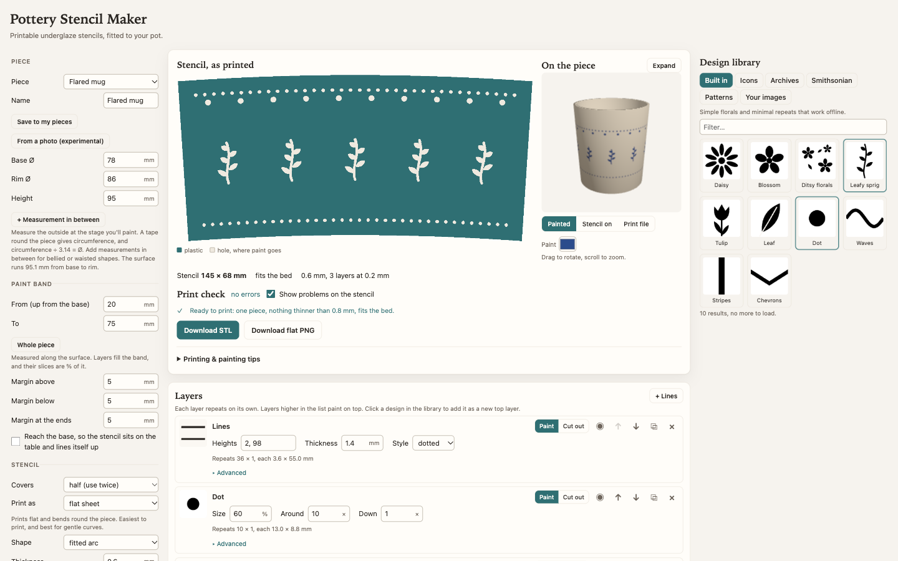

# Pottery Stencil Maker

Design underglaze stencils for your pottery and 3D print them. You measure the band you want to paint on a mug, pot, vase, bowl or plate rim. Then you layer designs from open libraries, or your own images, onto it and download an STL that fits the piece.



- **Fits the piece.** A tapered pot gets an arc-shaped stencil, because a flat sheet only lies flush on a cone if it's cut that way. A plate rim gets a ring.
- **Prints first time.** A print check finds plastic that's too thin to print, paint lines that would close up, pieces that would fall out, and spans that would sag, and it won't let you download a broken stencil by accident.
- **Prints flat or curved.** A flat sheet bends round the piece. A curved shell prints upright, already in the pot's shape, and has no bending to fight.

## Run it

You need [Node.js](https://nodejs.org) 22 or later.

```sh
git clone https://github.com/aasimsani/pottery-stencil-maker.git
cd pottery-stencil-maker
npm install
npm run dev
```

Then open http://localhost:5173. Everything runs in your browser, and your designs are saved there too.

To host it yourself, run `npm run build` and put the `dist/` folder on any static host. It also runs from the folder directly with `npm run preview`.

## Make a stencil

1. **Describe the piece.** Pick a preset, or enter its base Ø, rim Ø and height in mm. A tape round the piece gives the circumference, and circumference ÷ 3.14 is the Ø. For bellied or waisted shapes, add measurements in between. Measure at the stage you'll paint, because clay shrinks. **Save to my pieces** keeps a piece for next time.
2. **Place the paint band.** Set where the pattern starts and ends, in mm up from the base along the surface. **Margins** add a plastic border round it. **Reach the base** runs the bottom margin down to the table, so the stencil lines itself up when you set the pot on it.
3. **Add designs.** Click any design in the **Design library** to add it as a layer. Each layer has its own size and its own repeats around and down. Open **Advanced** for a layer's slice of the band, offset, rotation, scatter, threshold and **Thicken lines**. A **Paint** layer adds paint, and **Cut out** removes it. **Clear margin** keeps lower layers away from a shape, so a motif can sit cleanly on a busy pattern. **+ Lines** adds solid, dashed, dotted or wavy bands at any heights.
4. **Choose flat or curved.** Under **Stencil**, a **flat sheet** prints flat and bends round the piece. A **curved shell** prints standing up in the piece's exact shape. Half and third stencils clip on from the side, past a handle. A full wrap leaves a 3 mm slit so it springs open.
5. **Check it.** Fix anything the **Print check** marks as an error. **Show problems** highlights each spot on the stencil. **Print file** in the 3D view shows the exact STL on your printer's bed.
6. **Download the STL** and slice it.

## Print it

The defaults suit a Bambu Lab P2S with a 0.4 mm nozzle. You can change the bed size and nozzle under **Printer & safety settings**.

| | Flat sheet | Curved shell |
|---|---|---|
| Material | PETG. It survives bending and reuse. | PLA. It doesn't bend, and it strings less than PETG. |
| Thickness | 0.6 mm (3 layers at 0.2 mm) | 0.8 mm, printed with 2 wall loops |
| Placement | Exactly as exported. A long stencil may come rotated to fit the bed diagonally. | Upright, exactly as exported. Leave slicer supports off, because the file already holds any posts it needs. |
| Plate | Textured PEI. Flex the cooled plate to peel it off. | Textured PEI. |

- **Brim:** turn it off.
- **Stringing:** dry your filament, turn on wipe while retracting, and run PETG at about 235 °C. A few seconds of hair dryer clears any strings left over.

**Painting.** Tape the stencil on, or hold it with a rubber band. Dab underglaze on with a sponge or stencil brush, because brushing pushes paint under the edges. Lift the stencil straight off. Touch up the thin unpainted lines that bridges leave, or paint a second pass with the stencil shifted slightly.

## Design sources

| Source | What you get | Licence |
|---|---|---|
| Built in | A few florals and minimal repeats | MIT, with this project |
| [Iconify](https://iconify.design) | 300,000+ open-source icons | Per icon set, shown in the app's credits |
| [Wikimedia Commons](https://commons.wikimedia.org) | Biodiversity Heritage Library scans and SVG clip art | Per file, shown in the app's credits |
| [Smithsonian Open Access](https://www.si.edu/openaccess) | Museum images | CC0. The built-in demo key allows about 10 searches an hour, and a [free key](https://api.data.gov/signup/) removes the limit. |
| [Pattern Monster](https://pattern.monster) | 330 seamless patterns | MIT. See `src/sources/data/PATTERN-MONSTER-LICENSE` |
| [Hero Patterns](https://heropatterns.com) by Steve Schoger | 87 seamless patterns | CC BY 4.0 |

The **Credits** list under your layers names every source you used. CC BY designs need that credit if you sell or publish the pieces.

## Limits

- **Photo tracing is experimental.** It needs a plain background and a level, distant shot. Check its numbers before you print.
- **Strongly bellied walls can't be covered flush** by a flat sheet or a cone-shaped shell. The app warns when a band curves more than 1.5 mm away from the stencil.
- **The live libraries need a connection.** Built-in designs and patterns work offline.

## Development

```sh
npm test            # Vitest, about 100 tests of the geometry, mesh, checks and sources
npm run typecheck
npm run build       # typecheck, then a static build in dist/
```

The pipeline runs in this order:

1. `src/core/piece.ts` describes the piece as a base-to-rim profile. It fits the stencil to the cone through the surface the stencil covers, with separate margins above, below and at the ends. `src/core/photo.ts` traces a profile from a photo.
2. `src/core/geometry.ts` unrolls the band into an annular sector, and `wrap()` maps a flat point back onto the pot.
3. Each layer in `src/layers.ts` renders one repeat cell. `src/render/tile.ts` draws designs on a canvas and thresholds them, and `src/core/lines.ts` draws lines layers directly.
4. `src/core/mask.ts` composites the layers onto the sector, bottom first, and bridges loose pieces. `src/core/flaps.ts` holds wide pieces at both ends, and `src/core/overhang.ts` adds support posts to curved shells.
5. `src/core/mesh.ts` extrudes the result into a closed binary STL. `src/core/shell.ts` bends it into a curved shell, and `src/core/bed.ts` finds a rotation that fits the bed.
6. `src/checks.ts` runs the print check, using `src/core/thin.ts` to find features below the minimum widths.

`src/pipeline.ts` chains these steps. `prepareStencil()` renders the layers on the page, and `finishStencil()` runs the rest in `src/stencil.worker.ts` so the page stays responsive. The UI lives in `src/ui/`, and settings and layers persist in `localStorage`.

**Adding a design source:**
1. Add its id to `SourceId` in `src/sources/types.ts`.
2. Write `src/sources/<name>.ts` with a pure `parse…(json)` function that returns `DesignRef`s, and test it against a saved API response in `src/sources/__fixtures__/`. The image host must send `Access-Control-Allow-Origin`, because the threshold step reads canvas pixels.
3. Add a `case` in `src/render/art.ts` that loads the full-size art.
4. Add a tab in `src/ui/Library.tsx`.

`node scripts/vendor-pattern-monster.mjs` refreshes the bundled Pattern Monster data.

## Licence

MIT. See `LICENSE`. Third-party designs keep their own licences, listed above.
